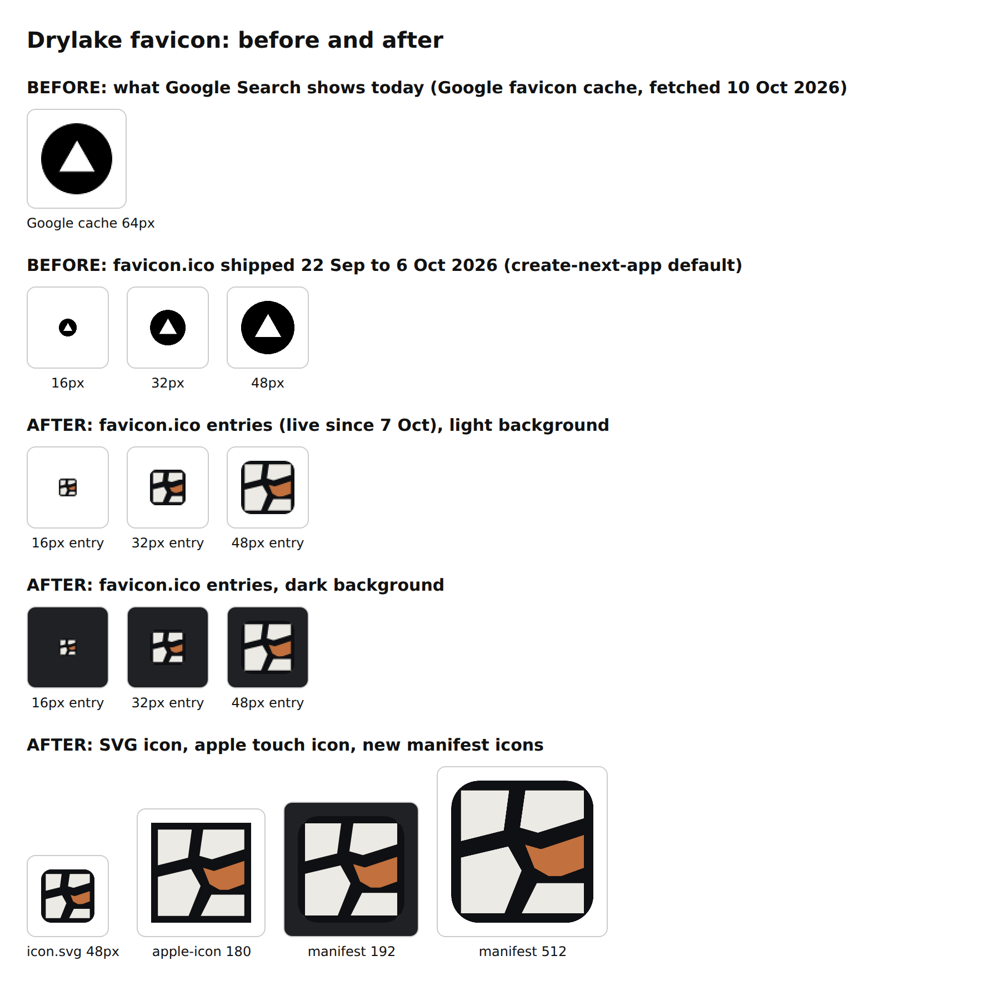

# Google Search favicon (2026-10-10)

## Cause

Google Search shows a white triangle in a black circle beside drylake.com.au. That is the
Vercel logo, the default `favicon.ico` that `create-next-app` ships. It was in the repo from the
first commit (2a83566, 22 Sep 2026) until the brand commits on 6 and 7 Oct (ad78919, then
f7d4589 adopting Wilson's cracked lake-bed tile, drylake-ops D27). Google fetched the favicon
while the default was live and has not re-crawled it since.

Fetched on 10 Oct 2026: Google's favicon service
(`t2.gstatic.com/faviconV2?...url=https://drylake.com.au`) still returns the triangle, while
`https://drylake.com.au/favicon.ico` returns the tile (3,184 bytes, HTTP 200), so the site
itself was already correct. The stale icon is in Google's cache, not on the site.

## What was checked (production, 10 Oct)

| Check | Result |
|---|---|
| `/favicon.ico` | 200, `image/vnd.microsoft.icon`, 16/32/48 px tile |
| `/icon.svg`, `/apple-icon.png` | 200, the tile |
| Googlebot, Googlebot-Image and Google-Favicon user agents on `/favicon.ico` | 200 each (no firewall block) |
| robots.txt | `Allow: /` for `*`; no rule touches the icon paths |
| Auth | Clerk proxy matcher excludes `.ico`, `.png`, `.svg` and `.webmanifest` |
| Conflicting declarations | None: no `public/favicon.*`, no `icons` in layout metadata |
| Caching | `/favicon.ico` is `max-age=0, must-revalidate`; the `<link>` URLs carry a content hash (`?favicon.<hash>.ico`), so browsers and the Vercel CDN pick up a change on deploy without extra cache busting |
| Missing | No web app manifest (`/manifest.webmanifest` 404), so no 192/512 icons |

## This PR

- `app/manifest.ts`: manifest with 192 and 512 px PNGs of the tile and the SVG icon.
- `public/brand/drylake-app-icon-{192,512}.png`, rendered from `public/brand/drylake-mark-tile.svg`
  by `scripts/brand/render-app-icons.mjs` (Playwright Chromium, already a dev dependency).
- `tests/favicon.test.mjs`: fails if the scaffold favicon returns (sha256), if the ICO loses its
  48 px entry, if a second favicon source appears, or if the manifest icons drift.
- The existing `favicon.ico`, `icon.svg` and `apple-icon.png` are unchanged; they are already the
  official tile.

## Search Console (after merge and deploy)

Google decides when the favicon in results changes. Nothing on the site can force it, and this
PR does not claim Search has updated.

1. Search Console, property `drylake.com.au` (needs a verified owner; see the audit's open
   decision on ownership).
2. URL Inspection: enter `https://drylake.com.au/`.
3. **Request indexing.** Google re-reads the homepage and its `<link rel="icon">` tags; the
   favicon crawler follows on its own schedule, typically days to a few weeks.
4. Check progress without Search Console:
   `https://t2.gstatic.com/faviconV2?client=SOCIAL&type=FAVICON&fallback_opts=TYPE,SIZE,URL&url=https://drylake.com.au&size=64`
   When that returns the tile, results will follow.
