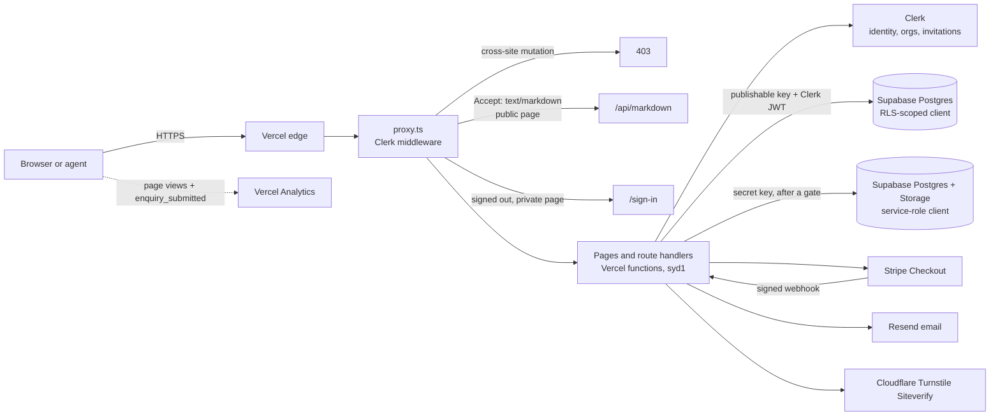

# Developer guide

How the drylake.com.au codebase is put together, how to run and test it, and how changes reach
production. Written 2026-10-08 against `main` at `f18270d` (includes PR #53, Markdown for
agents) plus the `feat/ai-discoverability-code-quality` branch. Every statement was checked
against the code; where a fact lives only in a dashboard, it says so.

Deeper references, not repeated here:

| Topic | Document |
|---|---|
| Components, data flows, request layers | [production-readiness/architecture.md](production-readiness/architecture.md) |
| Threat model, every API route's controls, service-role uses, Stripe, headers | [security/README.md](security/README.md) and the files it indexes |
| Contact form contract, token replay, rate limit | [operations/contact-form.md](operations/contact-form.md) |
| Backups, restore, rollback, secrets, DNS | [operations/disaster-recovery/README.md](operations/disaster-recovery/README.md) |
| Search and AI discoverability | [discoverability/README.md](discoverability/README.md) |
| Known gaps not yet fixed | [production-readiness/deferred-findings.md](production-readiness/deferred-findings.md) |

## 1. Architecture at a glance



Stack: Next.js 16 App Router (`next@^16.3.8`), React 19.2, TypeScript, Tailwind CSS 4, Clerk
(`@clerk/nextjs` 7), Supabase (`@supabase/supabase-js` 2), Stripe 23, Resend 6, Vercel Analytics.
`AGENTS.md` warns that this Next.js version differs from older docs: read
`node_modules/next/dist/docs/` before using an unfamiliar API. Middleware is `proxy.ts` (the
Next 16 name), not `middleware.ts`.

There are **no server actions** (`"use server"` appears nowhere). Every mutation is a route
handler under `app/api/**`.

## 2. Directory structure

| Path | What lives there |
|---|---|
| `app/` (public) | `page.tsx` (home), `about`, `solutions`, `services`, `services/[slug]` (static params), `perth`, `contact`, `privacy`, `terms`; `error.tsx`, `global-error.tsx`, `not-found.tsx` |
| `app/` (machine surfaces) | `sitemap.ts`, `robots.txt/route.ts` (PR #53, adds Content-Signal), `llms.txt/`, `llms-full.txt/`, `.well-known/api-catalog/route.ts` (PR #53, RFC 9727) |
| `app/sign-in`, `app/sign-up` | Branded Clerk screens; layouts wrap them in `ClerkScope` |
| `app/portal` | Router page (admin to `/admin`, everyone else to `/client`), `accept-invitation` (public on purpose), `workspaces` (multi-organisation picker) |
| `app/client` | Client workspace: dashboard, `billing`, `billing/[invoiceId]`, `projects/[projectId]`; own `error.tsx` and `not-found.tsx` |
| `app/admin` | Admin dashboard, clients, projects, invoices, payments, documents and create forms (17 pages) |
| `app/api` | 19 route handlers plus `markdown` (PR #53): `admin/**`, `client/**`, `contact`, `health`, `stripe/checkout`, `stripe/webhook`. Route-by-route controls: [security/api-security-matrix.md](security/api-security-matrix.md) |
| `components/` | `admin`, `auth` (ClerkScope), `billing`, `brand`, `client`, `forms` (ProjectForm, TurnstileWidget), `layout`, `motion`, `navigation`, `sections`, `seo`, `shell`, `system`, `ui`, `visuals` |
| `lib/admin` | Admin filter sanitising and cross-table search |
| `lib/analytics` | `enquiry-event.ts`: the `enquiry_submitted` custom event (this PR) |
| `lib/auth` | Admin gates, workspace resolver, Clerk onboarding, audit writer, return-path rules |
| `lib/clients` | Client status lifecycle, invitation helpers, onboarding validation |
| `lib/contact` | Enquiry validation, Turnstile verification, token replay store, browser submit wrapper |
| `lib/discovery` | Entity facts, crawler policy, JSON-LD, llms.txt, IndexNow, Markdown negotiation and conversion (PR #53), API catalogue |
| `lib/email` | Resend client, enquiry and invoice email rendering |
| `lib/health` | Pure `/api/health` report |
| `lib/invoice-creation`, `lib/invoices` | DRAFT validation; GST, lifecycle, Stripe decisions, webhook verification, invoice email delivery, invoice URLs |
| `lib/navigation`, `lib/perf`, `lib/security`, `lib/validation` | Public nav rules; timing logs; CSRF decision and CSP; UUID and file-signature checks |
| `lib/supabase` | `server.ts` (RLS client), `admin.ts` (service role), token-shape and RLS-miss diagnostics |
| `lib/*.ts` | `business.ts` (legal identity, `gstRegistered`), `tax.ts`, `stripe.ts`, `site.ts` (`RESPONSE_TIME`, `CONTACT_EMAIL`), `seo.ts`, `seo-pages.ts`, `faqs.ts` |
| `tests/*.test.mjs` | Unit and source-contract suite (`npm test`) |
| `tests/e2e/` | Playwright suite (`npm run test:e2e`) |
| `scripts/` | `env-registry.mjs` (every env var, names only), `generate-env-example.mjs`, `check-env.mjs`, `check-migrations.mjs`, `discoverability-check.mjs`, `live-matches-main.mjs`, `indexnow-submit.mjs`, `stripe-reconcile.mjs` (read-only) |
| `docs/` | Everything linked in this guide; `docs/operations/sql/` holds one-off SQL run by hand |
| `supabase/migrations/` | **One file only**: `20261005120000_client_status_lifecycle.sql` (see section 4) |

## 3. Authentication and authorisation

**Clerk answers "who is this". The app and RLS answer "what may they see".**

| Layer | What it does | Code |
|---|---|---|
| 1. `proxy.ts` | Refuses cross-site `POST`/`PUT`/`PATCH`/`DELETE` to `/api/*` with 403 (Stripe webhook exempt). Rewrites public pages requested as Markdown. Redirects signed-out requests for `/admin`, `/client`, `/portal` pages to `/sign-in?redirect_url=<path>`. `/portal/accept-invitation` stays public so Clerk's ticket survives. API routes are never redirected; they answer 401/403 themselves | `proxy.ts`, `lib/security/same-origin.ts`, `lib/security/csp.ts` |
| 2. Admin pages | `requirePlatformAdmin(returnTo)` in 9 pages, inline `isPlatformAdmin()` in 8, always **before** the service-role client is created. `app/admin/layout.tsx` also checks, but a layout is not a guard (it does not re-run on client navigation) | `lib/auth/guards.ts`, `lib/auth/platform-admin.ts` |
| 2. Admin APIs | `authorizeAdminApi()` (303 to sign-in for a form navigation, 401 for fetch, 403 for non-admin) in 6 routes; an inline `auth()` + `isPlatformAdmin()` check in 7 (billing, projects, invoices, milestone status, milestones, updates, documents). Ordering is enforced by `tests/security-hardening.test.mjs` | `lib/auth/admin-api.ts` |
| 2. Client pages and APIs | `getClientWorkspace()` resolves the caller's Clerk organisation to exactly one `organizations` row and returns a state: `signed-out`, `lookup-failed`, `no-organisation`, `blocked`, `access-pending` or `ready` (carrying the RLS client that verified it). Memoised per request | `lib/auth/client-context.ts`, `lib/auth/access.ts` |
| 3. Supabase RLS | Final tenant boundary for every client read. Policies key on the Clerk org in the JWT and **live only in Supabase**, not in the repo | [security/rls-and-tenant-isolation.md](security/rls-and-tenant-isolation.md) |

`isPlatformAdmin()` looks the Clerk user id up in `platform_admins` with the service role. There
is one admin trust tier: any platform admin can act on every client.

**Sign-in and sign-up:** `/sign-in` and `/sign-up` render Clerk components with
`fallbackRedirectUrl="/portal"`; `NEXT_PUBLIC_CLERK_SIGN_IN_URL` / `_SIGN_UP_URL` must point at
them. ClerkProvider is not in the root layout: `components/auth/ClerkScope.tsx` adds it only to
auth, portal, client and admin segments.

**Invitations:** an admin creates a client (`POST /api/admin/clients`), which creates a Clerk
organisation, the `organizations` row and an `org:member` invitation (14-day expiry, redirect to
`<canonical origin>/portal/accept-invitation`). The landing page forwards `__clerk_ticket` to
`<SignIn>` or `<SignUp>`. Back at `/portal`, `POST /api/client/invitations/complete` (stricter
Origin check: an absent Origin is refused) accepts any further pending invitations for
verified addresses. Full sequence: architecture.md, flows A and B; operator steps:
[operations/client-portal-onboarding.md](operations/client-portal-onboarding.md).

**Where the service-role client is allowed, and why.** It bypasses RLS, so it may only run after
a check that already proved the caller's right:

| Caller | The check that comes first |
|---|---|
| Admin pages and admin APIs | Platform-admin gate |
| `isPlatformAdmin()` itself | Clerk session (reads only `platform_admins`) |
| Workspace mapping in `getClientWorkspace()` | Clerk-verified org ids (never browser input); maps ids to `id, name, status` only, client data is then read with RLS |
| Document download | RLS-scoped read of the document first, then a 60 second signed URL |
| Stripe webhook | Verified Stripe signature |
| `/api/contact` | Only for the `turnstile_token_claims` replay store; no enquiry data is stored |

Every use is listed and justified in [security/service-role-audit.md](security/service-role-audit.md);
`tests/security-hardening.test.mjs` allow-lists the call sites.

## 4. Database access patterns

| Client | Factory | Key | Use |
|---|---|---|---|
| RLS-scoped | `createServerSupabaseClient()` (`lib/supabase/server.ts`) | Publishable key + the caller's Clerk session token | Every client-portal read. **Fails closed**: with no Clerk token the query throws instead of silently running as anon |
| Service role | `createAdminSupabaseClient()` (`lib/supabase/admin.ts`, `server-only`) | `SUPABASE_SECRET_KEY` | Section 3 table only |

Client queries also filter explicitly on `organization_id` from the workspace, so isolation does
not depend on RLS alone. Neither client is typed with a generated `Database` schema yet, so rows
are untyped (deferred until the schema is committed).

**Tables used by the code:** `organizations`, `projects`, `milestones`, `project_updates`,
`documents`, `invoices`, `invoice_notifications`, `audit_logs`, `platform_admins`,
`turnstile_token_claims`. Storage: private bucket `client-documents`.

**`audit_logs`** is written for every admin mutation and payment event, through
`writeAuditLog()` (`lib/auth/audit.ts`) or an inline insert in the older routes. A failed audit
write is logged and never undoes the action.

**Schema is not in Git.** Only `supabase/migrations/20261005120000_client_status_lifecycle.sql`
is committed. Tables, RLS policies, grants and functions were built in the Supabase dashboard;
`docs/operations/sql/` holds hand-run scripts (for example the `turnstile_token_claims` table).
`scripts/check-migrations.mjs` (Schema workflow) checks migration names now and will check drift
once a baseline lands. Plan: [operations/disaster-recovery/schema-as-code.md](operations/disaster-recovery/schema-as-code.md).

## 5. Enquiry lifecycle

```
ProjectForm (/contact) or MessageDrylake (portal, projectType "Drylake Workspace: <topic>")
  -> Turnstile widget token
  -> submitEnquiry()                      lib/contact/submit-enquiry.ts (browser, 20 s timeout)
  -> POST /api/contact                    app/api/contact/route.ts
       size (Content-Length and real bytes), JSON content type, field rules (validate-enquiry.ts)
       Turnstile Siteverify bound to action + hostname, single-use claim (turnstile.ts, consumed-tokens.ts)
       portal sender context, server-verified (portal-context.ts)
       Resend to CONTACT_TO_EMAIL         lib/email/contact-enquiry.ts
  <- 200 { success: true } only after Resend accepted the message
  -> trackEnquirySubmitted()              lib/analytics/enquiry-event.ts (Vercel Analytics custom event)
```

- **No database storage of enquiries.** The only row written is the token fingerprint claim.
- The browser shows success only for a 2xx with `success: true`. Every failure keeps the answers
  and asks for a fresh Turnstile token.
- `enquiry_submitted` fires **client-side, only on confirmed delivery** (the single success branch
  of `submitEnquiry`). Properties are a closed set: `surface` (`public` or `portal`) and
  `projectType` (a public dropdown value or `other`). Never add personal data. Custom events report
  only on a Vercel Pro plan; on Hobby the call is accepted and dropped.
- Rate limiting is a Vercel Firewall rule (dashboard), not code.

Status codes and log rules: [operations/contact-form.md](operations/contact-form.md).

## 6. Stripe payment lifecycle

Invoice statuses (`lib/invoices/lifecycle.ts`): `DRAFT -> OPEN -> (OVERDUE) -> PAID`, and `VOID`
from any unpaid state. Amounts are integer cents; GST comes only from `lib/invoices/gst.ts`.

| Step | Route | Key rule |
|---|---|---|
| Draft | `POST /api/admin/clients/[organizationId]/invoices` | Validated by `lib/invoice-creation/validate.ts`; a `requestId` in `audit_logs` dedupes double submits (check-then-insert, not atomic) |
| Issue | `POST /api/admin/invoices/[invoiceId]/issue` | DRAFT to OPEN, conditional on status and stored total, GST recalculated, audit `INVOICE_ISSUED`, then email with links from `APP_BASE_URL` |
| Resend | `POST /api/admin/invoices/[invoiceId]/resend` | Re-emails OPEN or OVERDUE; never changes status |
| Checkout | `POST /api/stripe/checkout` | Active Clerk org + RLS read of the invoice; amount and currency only from the stored invoice; reuses or expires a prior session; `idempotencyKey` from `checkoutIdempotencyKey()` |
| Paid | `POST /api/stripe/webhook` | **The only writer of PAID.** Raw-body signature check (300 s tolerance) first; update conditional on the status read; PAID is terminal, so retries and duplicates converge; audit `INVOICE_PAYMENT_RECEIVED`; permanent problems become `INVOICE_PAYMENT_ANOMALY` rows and return 2xx; transient ones return 5xx so Stripe retries |

The success redirect from Checkout is never authoritative; `PaymentReturnNotice` polls until the
server shows PAID. Details: [security/stripe-security.md](security/stripe-security.md); rebuilding
paid state: [operations/disaster-recovery/stripe-reconciliation.md](operations/disaster-recovery/stripe-reconciliation.md).

## 7. Third-party integrations

| Service | Purpose | Env vars | Data location |
|---|---|---|---|
| Vercel | Hosting, functions, firewall, analytics | `VERCEL_*` (platform) | Functions pinned to `syd1` (Sydney) by `vercel.json`. Analytics and edge are Vercel platform services, not covered by the pin |
| Supabase | Postgres system of record, private file storage | `NEXT_PUBLIC_SUPABASE_URL`, `NEXT_PUBLIC_SUPABASE_PUBLISHABLE_KEY`, `SUPABASE_SECRET_KEY` | ap-southeast-2 (Sydney), confirmed by Ben 2026-10-06 |
| Clerk | Identity, sessions, organisations, invitations | `NEXT_PUBLIC_CLERK_PUBLISHABLE_KEY`, `CLERK_SECRET_KEY`, `CLERK_JWT_KEY`, `NEXT_PUBLIC_CLERK_SIGN_IN_URL`, `NEXT_PUBLIC_CLERK_SIGN_UP_URL` | United States; Clerk offers no region choice. Frontend API on `clerk.drylake.com.au` |
| Stripe | Checkout and payment confirmation | `STRIPE_SECRET_KEY`, `STRIPE_WEBHOOK_SECRET` | Stripe (United States) |
| Resend | Invoice email and enquiry delivery | `RESEND_API_KEY`, `EMAIL_FROM`, `CONTACT_EMAIL_FROM`, `CONTACT_TO_EMAIL` | United States |
| Cloudflare Turnstile | Bot check on both enquiry forms | `NEXT_PUBLIC_TURNSTILE_SITE_KEY`, `TURNSTILE_SECRET_KEY`, `TURNSTILE_ALLOWED_HOSTNAMES` | Cloudflare global network; only the token is sent |
| IndexNow | Tells Bing and others that public URLs changed | none (key is public by design) | Called from GitHub Actions, not the app |

## 8. Environment variables

Source of truth: `scripts/env-registry.mjs`. `.env.example` is generated from it
(`node scripts/generate-env-example.mjs`; do not edit by hand), `tests/production-readiness.test.mjs`
fails when code reads an unlisted variable, and `scripts/check-env.mjs` audits a pulled
environment without printing values. **Never put a value in the repo.**

| Name | Req. | Exposure | Purpose |
|---|---|---|---|
| `NEXT_PUBLIC_SUPABASE_URL` | yes | public | Supabase project URL |
| `NEXT_PUBLIC_SUPABASE_PUBLISHABLE_KEY` | yes | public | RLS-bound client key |
| `SUPABASE_SECRET_KEY` | yes | secret | Service role, bypasses RLS |
| `NEXT_PUBLIC_CLERK_PUBLISHABLE_KEY` | yes | public | Clerk frontend key |
| `CLERK_SECRET_KEY` | yes | secret | Clerk Backend API |
| `NEXT_PUBLIC_CLERK_SIGN_IN_URL` / `_SIGN_UP_URL` | yes | public | Must be `/sign-in` and `/sign-up` |
| `CLERK_JWT_KEY` | no | server | PEM public key for networkless session verification (`proxy.ts`) |
| `STRIPE_SECRET_KEY` | yes | secret | Checkout sessions |
| `STRIPE_WEBHOOK_SECRET` | yes | secret | Webhook signature |
| `RESEND_API_KEY` | yes | secret | Email delivery |
| `EMAIL_FROM` | yes | server | Verified sender (invoices; default for enquiries) |
| `CONTACT_EMAIL_FROM` | no | server | Overrides the enquiry sender |
| `CONTACT_TO_EMAIL` | yes | server | Enquiry inbox |
| `NEXT_PUBLIC_TURNSTILE_SITE_KEY` | yes | public | Widget site key |
| `TURNSTILE_SECRET_KEY` | yes | secret | Siteverify |
| `TURNSTILE_ALLOWED_HOSTNAMES` | no | server | Extra accepted hostnames (for example a preview domain) |
| `APP_BASE_URL` | no | server | Canonical origin for emailed links; defaults to `https://drylake.com.au`; leave unset in production |
| `GOOGLE_SITE_VERIFICATION`, `BING_SITE_VERIFICATION` | no | server | Webmaster verification tags |
| `VERCEL_ENV`, `VERCEL_REGION`, `VERCEL_GIT_COMMIT_SHA` | no | platform | Set by Vercel; never configure by hand |

Secrets are read lazily: a missing one throws on first use, and `/api/health` reports how many
required variables are missing (never which).

## 9. Local development

```bash
npm ci                      # or npm install
cp .env.example .env.local  # fill in what you have; never commit it
npm run dev                 # http://localhost:3000
```

| Without real credentials | Result |
|---|---|
| Public pages, sitemap, robots, llms.txt, Markdown negotiation | Work |
| Contact form | Works up to delivery with Cloudflare's always-pass test keys (`1x00000000000000000000AA` site key, `1x0000000000000000000000000000000AA` secret, as in `playwright.config.ts`); without Resend config the route answers 502 by design |
| Sign-in, portal, admin | Need a real Clerk instance. Placeholder Clerk keys let the app build and render public pages but cannot create sessions |
| Client data, admin data, documents | Need a Supabase project with the dashboard-built schema and RLS (not reproducible from the repo yet) |
| Checkout and webhook | Need Stripe test keys; use the Stripe CLI to forward webhooks |

Never point a local `.env.local` at production Supabase or Stripe keys. Note that a local build is
not a measure of production performance (Clerk and region differ).

## 10. Testing

| Command | What it does |
|---|---|
| `npm test` | `node --conditions=react-server --test tests/*.test.mjs`. Node's own runner; tests import pure modules **by relative path with the `.ts` extension** (`../lib/discovery/entity.ts`). The `@/` alias does **not** resolve under `npm test`, so a module the tests import must use relative imports, and modules that use `@/` are checked as source text instead |
| `npx tsc --noEmit` | Typecheck. Stale `.next/types` from another branch can produce errors outside `app/` and `lib/`: delete `.next/types` or run after `npm run build` |
| `npx eslint .` | Lint |
| `npm run build` | Production build; must pass before a PR |
| `npm run test:e2e` | Playwright: builds, serves `next start` on port **3107** with Turnstile test keys and empty Resend config (no email can be sent), projects `desktop`, `mobile` (375x667) and `matrix`. `E2E_SKIP_BUILD=1` reuses `.next` |
| `npm run test:e2e:prod` | Same suite read-only against `https://drylake.com.au`; tests tagged `@local` (form submissions, stubs, test keys) are excluded |

**Source-text tests.** Several suites read source files and match code tokens
(`security-hardening`, `qa-regression-contracts`, `tenant-isolation`, `agent-readable`,
`portal-ux-performance`, `auth-navigation-performance`, `gst`, `health` and others). Some strip
comments first, some do not. **Never write a code token in a comment** (for example the admin
client factory call, a request body read, or the PAID status literal): describe it in words, or a
test may match the comment instead of the code. Run `npm test` after any comment-only change.

**CI** (`.github/workflows/`):

| Workflow | Trigger | Runs |
|---|---|---|
| `checks.yml` | PR to `main`, push to `main` | `npm ci`, `npm test`, `npx tsc --noEmit`, `npx eslint .` (Node 22). Not e2e: placeholder Clerk keys cannot create sessions (D30) |
| `schema.yml` | Every PR, push to `main` | `node scripts/check-migrations.mjs` |
| `discoverability.yml` | Successful Production deployment, weekly (Monday 07:00 AWST), manual | Live crawl/index check, live domain serves `main`'s HEAD, then IndexNow submission |

## 11. Deployment

- **Vercel** builds every push; production follows `main`. Functions run in `syd1`
  (`vercel.json`, guarded by `tests/deploy-region.test.mjs`).
- **Branch and PR only. Never push to `main`.** Branch protection is not available on the current
  GitHub plan, so this convention is the only control
  ([disaster-recovery/source-control.md](operations/disaster-recovery/source-control.md)).
- **Wilson reviews and merges.** Vercel does not build previews for PRs authored by Ben's account,
  so review the branch locally.
- After a production deploy, the Discoverability workflow must go green, including
  `live-matches-main` (two builds can race; the older one can take the domain).
- `GET /api/health` returns `ok` (200) or `degraded` (503) with `missingRequired`, `region`
  (must read `syd1`), `environment` and a 7-character commit. Point uptime monitors at it.
- Rollback: promote the previous deployment in Vercel
  ([disaster-recovery/vercel-recovery.md](operations/disaster-recovery/vercel-recovery.md)).
- Production environment audit: `vercel env pull` then `node scripts/check-env.mjs <file> production`,
  and delete the pulled file.

## 12. Where to look first when something breaks

| Symptom | Look first |
|---|---|
| `/api/health` is 503 | A required env var is missing in Vercel; run `scripts/check-env.mjs` against a pulled environment |
| `/api/health` region is not `syd1` | `vercel.json` and the Vercel project's function region setting |
| Enquiry form shows "couldn't send" | Vercel logs for `Contact enquiry delivery failed:` (Resend or missing `EMAIL_FROM`/`CONTACT_TO_EMAIL`); [contact-form.md](operations/contact-form.md) |
| Enquiry form shows security check failed | Turnstile error codes in logs; `TURNSTILE_SECRET_KEY`, hostname list, token claim table |
| 429 on `/api/contact` | Vercel Firewall rate-limit rule (dashboard) |
| 403 "Forbidden" on any API POST | `proxy.ts` cross-site refusal: the request's Origin or `Sec-Fetch-Site` is not same-origin |
| Client sees "pending" or no workspace | `getClientWorkspace()` state; RLS-miss diagnostic log line from `lib/supabase/rls-diagnostics.ts`; Clerk membership and `organizations.clerk_org_id`; `docs/operations/sql/2026-10-06-portal-rls-check.sql` |
| Admin bounced to `/client` | `platform_admins` row for the Clerk user id; `Platform admin authorization failed` in logs |
| Invoice paid in Stripe but not PAID here | Stripe dashboard webhook deliveries; `Stripe webhook refused` / `processing failed` logs; `INVOICE_PAYMENT_ANOMALY` rows in `audit_logs`; `scripts/stripe-reconcile.mjs` |
| Invoice email not sent | `invoice_notifications` row status; Resend dashboard; `APP_BASE_URL` |
| Document download fails | Download route logs; bucket `client-documents`; RLS on `documents` |
| Sign-in loops or Account Portal appears | `NEXT_PUBLIC_CLERK_SIGN_IN_URL` / `_SIGN_UP_URL`; Clerk dashboard domains |
| Site not indexed, AI crawler blocked | Discoverability workflow run; `robots.txt`; Vercel Firewall bot rules ([discoverability/README.md](discoverability/README.md) M8) |
| Production serves an old build | `live-matches-main` job; promote the right deployment in Vercel |
| Unit test fails after a comment edit | A source-text test matched a code token in your comment (section 10) |
| Any disaster (data loss, key leak, DNS) | [disaster-recovery/runbooks.md](operations/disaster-recovery/runbooks.md) |
